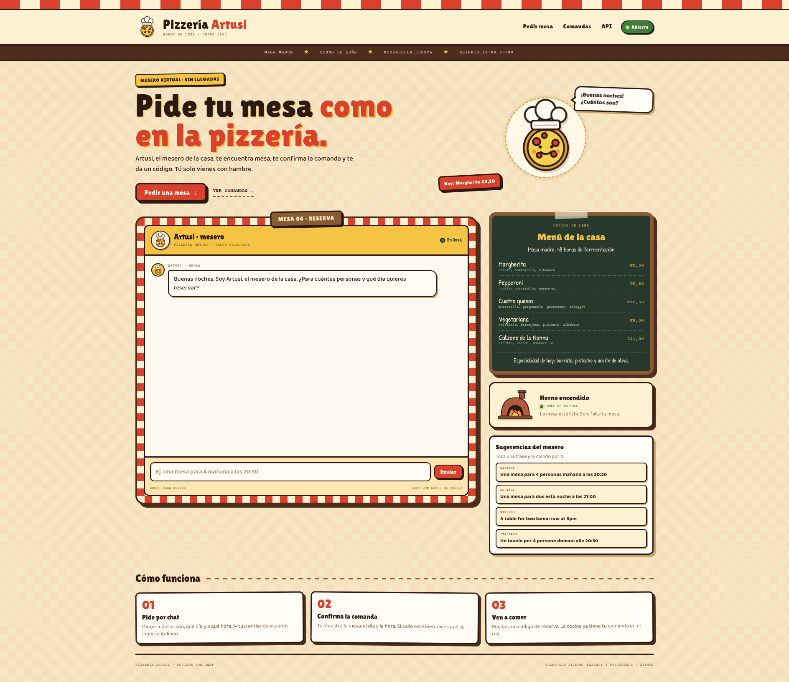
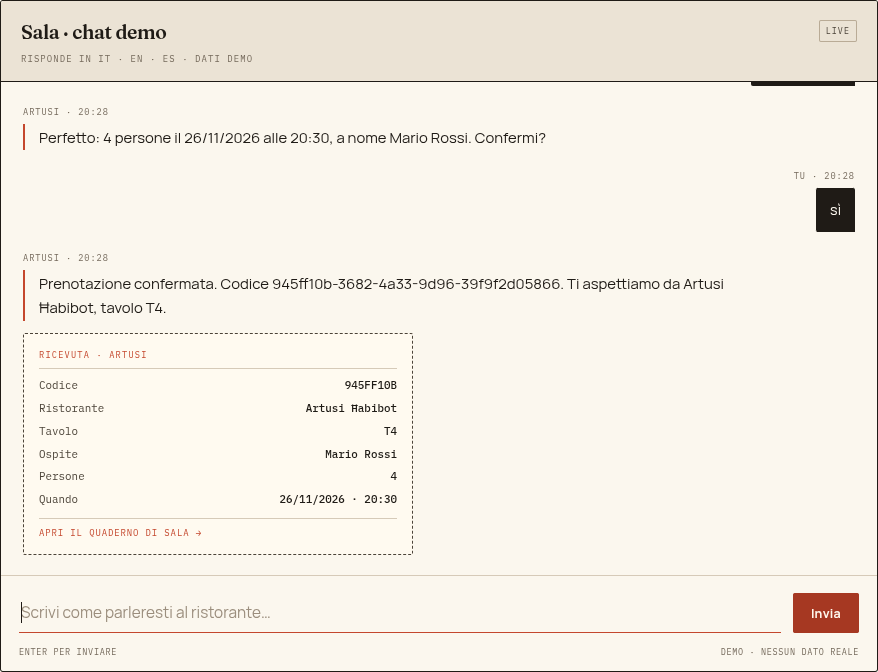
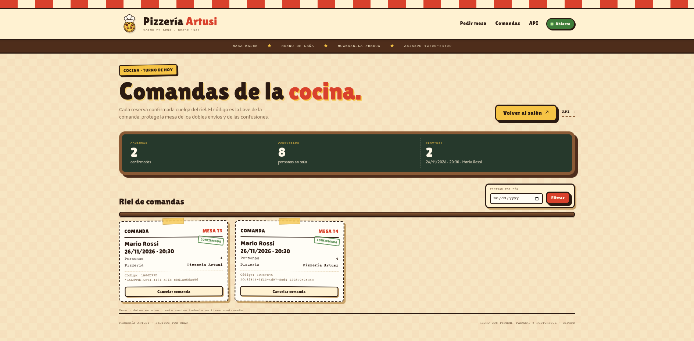

# Pizzería Artusi — Restaurant Booking MVP

A working vertical slice of a **classic pizzeria game** with a real booking
engine: chat in Spanish, Italian or English → availability check → table
assignment → idempotent confirmation → kitchen ticket rail.

The UI is a little pizzeria: checkered tablecloth, chalkboard menu, wood-fired
oven, pizza-chef mascot and hanging comandas. Behind it are **Python, FastAPI,
async SQLAlchemy, PostgreSQL** (SQLite for the zero-setup demo), **Jinja2** and
a small vanilla-JS chat client. The LLM is mocked by a deterministic parser so
the demo runs without keys; an OpenRouter adapter is ready for the real model.







## What it demonstrates

- **Multilingual chat** — understands `mañana a las 20:30`,
  `domani alle 20:30` and `tomorrow at 8pm`, then asks only for the missing
  fields. The UI is Spanish by default; the bot mirrors the guest's language.
- **Real availability engine** — 30-minute slots, 90-minute bookings,
  capacity-aware table assignment, lunch/dinner service window.
- **No double bookings** — overlapping bookings on the same table are rejected.
- **Idempotent confirmations** — retrying the same confirmation returns the
  same receipt instead of creating a second booking.
- **Kitchen ticket rail** — server-rendered admin page with date filter,
  covers, upcoming count and cancellation, styled as hanging comandas.
- **Pizzeria game UI** — checkered tablecloth, chalkboard menu, brick oven,
  pizza-chef mascot and a receipt with a confirmation stamp.
- **Tests** — domain, parser, conversation flows and HTTP API are covered.
- **Docker + PostgreSQL** — one command to run the production-like stack.

## See it in 60 seconds

### Option A — CLI demo, no database or keys

```bash
cd restaurant-booking-mvp
uv venv .venv
uv pip install --python .venv/bin/python -r requirements-dev.txt

.venv/bin/python -m app.demo
```

The script runs a complete Spanish conversation in memory and prints the
comanda and the kitchen ledger. Italian and English flows are covered by the
test suite and also work through the web chat.

### Option B — web demo with SQLite

```bash
DATABASE_URL='sqlite+aiosqlite:///./demo.db' \
  .venv/bin/uvicorn app.main:app --reload
```

Open <http://127.0.0.1:8000>. The kitchen comandas are at
<http://127.0.0.1:8000/admin>, and the API docs are at
<http://127.0.0.1:8000/docs>. Delete `demo.db` to reset the demo.

Or use the Makefile:

```bash
make run     # SQLite + reload
make demo    # terminal conversation
make test    # pytest
```

### Option C — Docker with PostgreSQL

```bash
docker compose up --build
```

Open <http://127.0.0.1:8000>. Stop with `docker compose down`; reset the
database with `docker compose down -v`.

## Architecture

```
Browser chat  ─┐
Telegram bot  ─┼─→  ConversationService  ─→  IntentParser
               │        │                      (mock / OpenRouter)
               │        ↓
               │   BookingService  ─→  availability + conflict checks
               │        │
               └────────┴─→  SQLAlchemy async  ─→  PostgreSQL / SQLite
```

The HTTP layer is a thin adapter. The conversation state machine, availability
rules and idempotency live in services, so the same flow can be driven by the
web chat, the Telegram adapter or a test.

### Booking rules

- Service window: **12:00–23:00 Europe/Rome** (seed data).
- Slot grid: every **30 minutes**.
- Booking duration: **90 minutes**.
- Table capacities: 2, 4, 6 and 8 seats.
- A table is free when no confirmed booking overlaps the requested interval.
- The smallest table that fits the party is selected.
- Start times must align with the slot grid and fit inside the service window.

### Idempotency

The confirmation key is derived from the conversation and the chosen slot:

```text
{session_id}:{table_id}:{start_at_iso}:{party_size}
```

It is unique in the database. If the same confirmation is submitted twice, the
service returns the existing booking. If two different requests race for the
same table, the database's unique constraint protects the idempotency key; the
overlap check is the next line of defence. For high concurrency, use a
PostgreSQL exclusion constraint (see the production checklist).

### Time zones

Datetimes are stored as **naive UTC** and converted at the edges. This keeps
SQLite and PostgreSQL behaviour identical in tests and avoids the classic
"aware vs naive" bug when a database driver drops `tzinfo`.

## Chat state machine

```text
idle
  → collecting      (asks party size → date → time)
  → asking_name     (asks for the name)
  → confirming      (shows summary and waits for yes/no)
  → confirmed       (returns receipt + booking code)
  → cancelled       (when the guest sends a cancellation code)
```

Short replies are supported (`4`, `tomorrow`, `20:30`) because the bot asks one
field at a time. The parser also understands a full sentence in one message.

## API

| Method | Path | Purpose |
| --- | --- | --- |
| `GET` | `/` | Chat demo |
| `POST` | `/chat` | Send a message; returns reply, state, missing fields and optional booking |
| `GET` | `/api/availability?day=YYYY-MM-DD&party_size=4` | Available table slots |
| `GET` | `/api/bookings?day=YYYY-MM-DD` | Confirmed bookings, optionally filtered by day |
| `POST` | `/api/bookings/{id}/cancel` | Cancel a booking |
| `GET` | `/api/reminders/due` | Bookings in the 23–25 hour reminder window |
| `GET` | `/admin` | Kitchen comandas (server-rendered ticket rail) |
| `GET` | `/health` | Health check |
| `GET` | `/docs` | OpenAPI docs |

Example:

```bash
curl -s http://127.0.0.1:8000/chat \
  -H 'Content-Type: application/json' \
  -d '{"session_id":"demo","message":"Una mesa para 4 personas mañana a las 20:30"}'
```

## Tests

```bash
.venv/bin/python -m pytest -q
```

The suite covers:

- availability, capacity, overlap and cancellation;
- idempotent repeat bookings and joined admin data;
- Italian, English and Spanish intent parsing;
- full chat flows, one-field-at-a-time replies and duplicate confirmations;
- HTTP pages, `/chat`, `/api/bookings`, `/api/availability` and cancellation;
- optional Basic Auth on `/admin` and the booking API.

Current result: **20 passed**.

## Public demo

A client-facing demo needs a public HTTPS URL, not a Tailscale address. The
repo includes a Render Blueprint (`render.yaml`), a Docker image and a deploy
checklist:

- [DEPLOY.md](DEPLOY.md) — Render / Railway / Fly steps.
- [docs/FREELANCER_PITCH.md](docs/FREELANCER_PITCH.md) — ready-to-paste messages
  for Freelancer and Workana.
- [docs/DEMO_SCRIPT.md](docs/DEMO_SCRIPT.md) — 60-second Loom script.

For a public deploy, set `DEMO_BASIC_AUTH=demo:<long-password>`. That protects
`/admin`, `/api/bookings` and `/api/reminders`; the chat stays public. The
public URL should use HTTPS.

## Mocked vs real

| Piece | In this build | To make it real |
| --- | --- | --- |
| Intent parser | Deterministic multilingual parser | `LLM_PROVIDER=openrouter` + `OPENROUTER_API_KEY`; adapter validates JSON and falls back to the mock |
| Telegram | Optional `aiogram` adapter | `pip install -r requirements-telegram.txt`, set `TELEGRAM_BOT_TOKEN`, run `python -m app.telegram_bot` |
| Reminders | `python -m app.reminders` prints messages | Cron/queue worker + Telegram/WhatsApp provider |
| WhatsApp / voice | Not included | Add a provider adapter behind the same `ConversationService` |
| Database | SQLite for local demo, PostgreSQL in Docker | Managed PostgreSQL, Alembic migrations |

### Real LLM

```bash
LLM_PROVIDER=openrouter \
OPENROUTER_API_KEY=sk-or-... \
OPENROUTER_MODEL=openai/gpt-4o-mini \
  .venv/bin/uvicorn app.main:app --reload
```

The model only extracts structured intent. Availability and confirmation stay
deterministic, so an LLM hallucination cannot create an invalid booking.

### Real Telegram

```bash
uv pip install --python .venv/bin/python -r requirements-telegram.txt
TELEGRAM_BOT_TOKEN='123456:ABC...' \
DATABASE_URL='sqlite+aiosqlite:///./demo.db' \
  .venv/bin/python -m app.telegram_bot
```

The adapter uses `tg:{chat_id}` as the conversation session, so the same state
machine and database are reused.

## Project layout

```text
app/
  booking.py          availability, table assignment, conflicts, idempotency
  conversation.py     state machine and multilingual copy
  intent.py           deterministic parser + OpenRouter adapter
  models.py           Restaurant, DiningTable, Booking, Conversation
  main.py             FastAPI app, HTTP API, admin page
  demo.py             zero-setup terminal demo
  telegram_bot.py     optional aiogram adapter
  reminders.py        mock reminder runner
  seed.py             demo restaurant and tables
  static/             pizza chef, pizza and wood-oven artwork
templates/
  base.html           pizzeria game design system
  chat.html           table-side chat + receipt
  admin.html          kitchen comanda rail
tests/                pytest suite
docs/                 screenshots
```

## Design notes

The interface follows a **classic pizzeria game** direction: a red-and-cream
checkered tablecloth, a chalkboard menu, a brick wood-fired oven, hanging
comandas, a pizza-chef mascot and chunky game buttons. The type pairing is
Lilita One + Baloo 2 + Courier Prime + Patrick Hand. There are no purple
gradients, no glassmorphism, no floating AI sparkles and no empty SaaS cards.

The page is laid out like a restaurant scene rather than a marketing page: the
chat lives on “Mesa 04”, the menu and oven sit beside it, and the admin view is
the kitchen ticket rail. The UI is Spanish; the bot replies in Spanish, Italian
or English depending on what the guest writes.

Accessibility details: semantic landmarks, a labelled chat input, `aria-live`
for bot replies, visible focus states, `prefers-reduced-motion` support, and a
responsive layout that keeps the table and comandas usable on mobile.

## Production checklist

This is an MVP, not a production deployment. Before exposing it to real guests:

- Add authentication to `/admin` and the write endpoints. The demo already
  supports optional Basic Auth via `DEMO_BASIC_AUTH`.
- Replace `Base.metadata.create_all` with Alembic migrations.
- Add a PostgreSQL exclusion constraint (or serializable transaction /
  `SELECT ... FOR UPDATE`) for the table-overlap check under concurrency.
- Add rate limiting, request size limits and abuse protection.
- Move reminders to an outbox + worker; send via the chosen provider.
- Store secrets in a manager, not `.env`; add structured logs, metrics and
  error reporting.
- Review GDPR/PII retention for guest names and phone numbers.
- Add per-restaurant tenancy, staff roles and an audit log.
- Test the real LLM adapter with adversarial prompts and a strict JSON schema.
- Add end-to-end tests against PostgreSQL, not only SQLite.

## Why this project

It is a small but complete slice of the work a restaurant booking product
needs: async Python, PostgreSQL, an LLM-ready intent layer, a Telegram-ready
adapter, deterministic business rules, idempotent writes, an operator view and
tests. The chat is the demo; the booking engine is the product.
